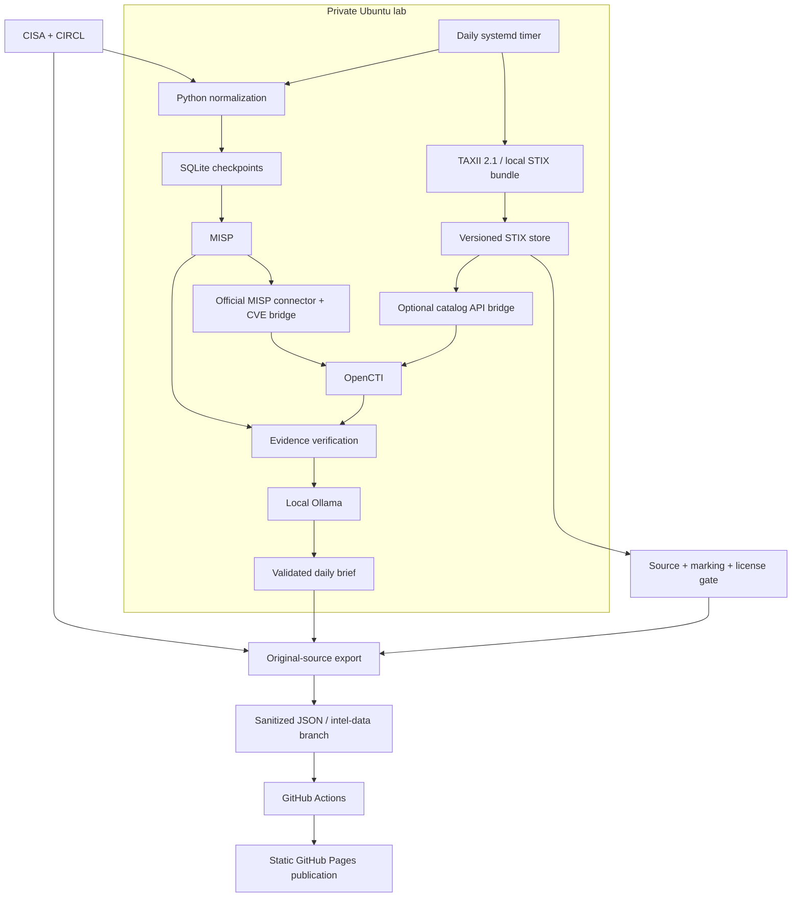

<h1 align="center">EMBER · Threat Intelligence Observatory</h1>

<hr>

<p align="center"><strong>MISP · OpenCTI · Ollama · Automated Threat Intelligence</strong></p>

<p align="center">
  
  
  
  
  
</p>

<p align="center">Public threat signals become private, correlated evidence and daily source-grounded briefs.<br>A separate publication boundary brings the safe results to a public intelligence dashboard.</p>

<p align="center">
  <a href="https://bran-dot-flake.github.io/STIX-TAXII-Threat-Intel-Automated-Summary/">Live Observatory ↗</a> ·
  <a href="#overview">Overview</a> · <a href="#objectives">Objectives</a> ·
  <a href="#architecture">Architecture</a> · <a href="#implementation">Implementation</a> ·
  <a href="#results">Results</a> · <a href="#setup">Setup</a>
</p>

<hr>

## Overview

EMBER is an automated threat intelligence publication backed by a private Ubuntu lab. It brings together exploited-vulnerability catalog entries, public indicators, security advisories, and structured MITRE ATT&CK® knowledge. Readers get a publication-wide daily brief, source-linked stories, useful trends, searchable CVEs, and historical editions on one static page.

The lab uses MISP to organize source-attributed observations, OpenCTI to represent intelligence entities and relationships, and an existing local Ollama model for exact evidence selection and a separate fact-cited narrative composition. A separate exporter publishes only validated public-source data. GitHub Pages remains available while the collector or model is offline.

## Objectives

- Automate collection without losing source attribution, object versions, or the distinction between catalog updates and observed attacks.
- Demonstrate real STIX 2.1 parsing and TAXII 2.1 discovery, collection retrieval, pagination, and incremental synchronization.
- Verify MISP/OpenCTI writes with independent read-back and durable checkpoints.
- Use local inference for evidence-grounded briefs while deterministic code supplies counts, relationships, and publication selection.
- Keep the reading experience compact and the private lab outside the public hosting boundary.

## Architecture



The feed/reporting path and STIX store are independent. MISP continues to own the existing IOC workflow. The optional STIX bridge imports approved MITRE catalog entities directly into OpenCTI; it does not force structured catalog objects into MISP events or introduce an always-running connector.

## Implementation

### Collection and evidence

The private pipeline collects CISA KEV additions from the last fourteen days and a bounded CIRCL public OSINT sample: three recently modified events with up to twenty supported attributes each. Stable MISP UUIDs and native OpenCTI upserts reconcile retries. The official MISP connector handles indicators/observables; a CVE-only API bridge fills its standalone vulnerability gap. Strict reporting verifies exact values and MISP provenance, rather than treating search candidates as proof.

The public exporter independently recollects up to ninety days of KEV additions, the bounded public CIRCL sample, and CISA advisory RSS. Editorial selection reserves room for distinct advisories instead of filling the feed with near-identical KEV bulletins. Related catalog updates are grouped, exact duplicate headlines are consolidated, and each original source link remains accessible. Introductory source sentences replace clipped CVE lists where possible.

KEV dates mean catalog additions, not exploitation or disclosure dates. IOC first-collected times are publication baselines, not attack occurrence. MITRE catalog modifications are knowledge-base updates, not daily threat events.

### STIX 2.1 and TAXII 2.1

The optional integration uses OASIS's `stix2` and `taxii2-client` libraries. Live discovery selects MITRE's Enterprise ATT&CK collection. Three bounded streams retrieve entities/observables, relationships, and identity/marking definitions. Common SDOs, SCOs, report object references, custom extensions, source STIX IDs, and original JSON remain in a separate SQLite store. Local bundle import uses the same parser without requiring a network or platforms.

SDO versions are keyed by source, STIX ID, and normalized modification timestamp. Exact repeats deduplicate; conflicting content at the same version fails closed. Unversioned observable variants retain content hashes and insertion order without invented modification dates. Latest active views exclude revoked/deprecated objects, while historical payloads remain available.

Each accepted page and its continuation token commit atomically. A bounded run resumes at its saved cursor; the incremental date-added checkpoint advances only after the complete traversal. Equal-timestamp overlap is deduplicated. Page-size/filter changes and changes to discovered release roots trigger bounded replay. Expired cursors queue replay from the previous safe watermark. This matters because MITRE can expose old date-added values for recently modified catalog content.

Transport uses TLS, same-origin endpoint checks, no redirects, bounded responses, timeouts, retries, and `Retry-After` handling. A persistent 35-request/ten-minute budget leaves headroom beneath [MITRE's documented rate limit](https://raw.githubusercontent.com/mitre-attack/attack-workbench-taxii-server/main/docs/USAGE.md). Optional basic or bearer credentials come from the private environment and never enter exported JSON or logs. [Full ingestion contract](docs/stix-taxii.md).

The OpenCTI catalog bridge supports attack patterns, intrusion sets, malware, tools, and their resolved source relationships. Native upserts preserve source STIX IDs and source references. Entity names/IDs and relationship types/endpoints are read back before checkpointing. It is an active catalog projection, not a complete replacement for OpenCTI's general STIX importer. Local storage retains metadata and lifecycle history beyond that projection.

### Briefing and publication

The front-page edition draws from the complete validated public publication, independently of the private eight-record synchronization batch. Its evidence package considers source-dated KEV additions, recent advisories, CIRCL events, proven substantive updates, and explicitly referenced historical/STIX context. Current catalog additions share one editorial story while their CVEs remain separate technical records. Indicators share a story only through the same original event URL. A vulnerability chain requires an explicit source reference; matching vendor or actor names cannot establish a relationship.

Ollama drafts a two-paragraph overview and concise supporting summaries with fact references. The independent gate checks complete source-derived formulations, conditions, names, dates, numbers and references; it allows punctuation/case changes and complete fact combinations, without treating similarity or valid IDs as proof. Freer paraphrases require private review. Unsupported supporting prose is withheld and replaced from source facts; an unsupported overview or unavailable model uses the deterministic fallback. The original draft stays in ignored local storage. The final plan and evidence digest are checked again before publication. This is deliberately bounded synthesis, not unrestricted or independently verified analysis. [Grounding and chronology contract](docs/briefing.md).

The lead targets roughly 120–170 words when evidence warrants it. It explains current developments first and supported significance/defensive considerations second, with two to four compact radar topics and expandable original evidence. Shared exploitation context and source recommendations appear once. Quiet windows do not recycle the historical backlog. Source publication/catalog dates, substantive changes, and collection times remain distinct; catalog additions never become newly observed attacks. The reporting window begins at the previous UTC midnight and ends at the edition's collection cutoff.

The original private exact-excerpt validator, synchronization/read-back and retry behavior remain intact. Staged operation replaces the private batch narrative call with one publication-wide call after original-source collection, rather than adding a third model call. With the approved resident profile restored, inference checks available memory (at least 3,500 MiB), reuses the same CPU-only model/two threads, and requests unload afterward. Low memory uses the safe fallback. No new model, service, package, or administrative unit is needed.

Public brief promotion requires exact independently recollected record versions and the batch digest. CIRCL event/object/attribute restrictions are checked and indicators defanged. STIX publication is limited to the reviewed original MITRE source and resolved permissive markings/license; local bundles and private TAXII feeds remain private. Only resolved, active source relationships enter the small public catalog. No actor/technique relationship is inferred from a headline or by the model.

The publisher writes one validated JSON file to `intel-data`, never stages the working tree or exports a token, and never force-pushes. Actions validates again and copies an asset allowlist. Individual source failures preserve accepted data and original success times. The frontend is plain HTML/CSS/JavaScript with same-origin assets, no framework/CDN, and no lab connection. [Public data contract](docs/publication.md).

## Results

[Open EMBER](https://brandonchaney.dev/STIX-TAXII-Threat-Intel-Automated-Summary/).


<details>
<summary>Phone layout</summary>


</details>

The current frontend removes the permanent sidebar, introductory masthead, standalone status view, and separate report/CVE pages. The reading order is Daily Brief → Latest Intelligence → Trends/statistics → Vulnerabilities → Archive. An asymmetric lead and compact “On the radar” column replace equal-sized topic blocks. News uses one featured story, two secondary entries and a compact headline index. Current, editorially selected and explicitly significant source reports rank before old bulletins. Dataset composition is collapsed beneath the smaller KEV trend chart; catalog context, CVEs, and historical editions expand in place. Article previews remain short, with complete excerpts and original sources accessible. The news index uses text rather than unrelated illustrations.

Supporting evidence groups CVEs and source reports without repeating the overview; individual records expand independently. Reader links use approved human-readable articles or local detail views, with original machine-readable feeds clearly labeled as raw source data. Latest Intelligence omits articles already featured by exact evidence ID or source URL while keeping distinct related reports, source categories, search and archives. Category filters and placeholder excerpts are omitted from the homepage.

The November 11, 2026 live TAXII acceptance stored **220 original STIX objects** across bounded/resumed requests. The accepted public projection contained **61 catalog objects and five resolved source relationships**. A real OpenCTI pilot read back catalog entities and relationships; an isolated three-object import repeated with **zero additional writes**. These are bounded acceptance samples, not complete Enterprise ATT&CK coverage.

The public feed snapshot also contained **114 KEV entries, 45 unique public IOCs, eighteen selected advisories, and two accepted briefs**. Those figures are dated evidence, not throughput or comprehensive coverage claims. The existing lab previously verified forty-one observations against MISP/OpenCTI and completed a real systemd-managed reporting run. [Validation evidence](docs/validation.md).

The expanded checks cover publication-wide selection, current advisories independent of batch reports, explicit source chains/context, partial narrative withholding, prepared publication without recollection, topic provenance, duplicate/conflicting evidence, narrative claim rejection, prompt injection, quiet days, unavailable Ollama, chronology and timestamp-only republication, parsing, relationships, lifecycle/version handling, pagination, resumable and incremental cursors, expired tokens, rate limits, marking restrictions, public filtering, platform read-back, frontend calculations, and the existing reporting path. Browser checks exercise the single-page interactions at phone, tablet, and desktop widths. Synthetic and unavailable-data states remain explicit.

The source mix remains bounded to the configured public feeds. The brief summarizes available evidence, not comprehensive cybersecurity coverage or local exposure.

## Setup

Python **3.11+** runs the core feeds, reports, export, and static build without external runtime packages. STIX/TAXII adds two optional libraries and their dependencies. Node 24 runs the JavaScript calculation tests. Browser acceptance uses optional development-only Playwright. The complete lab also needs Docker Compose and an existing Ollama installation.

### Preview and test

```sh
export PYTHONPATH=src
python3 -m pip install '.[stix]'  # isolated environment recommended
python3 -m unittest discover -s tests -v
node --test tests/dashboard.test.mjs
python3 scripts/validate.py
python3 -m ti_brief.cli --demo
python3 scripts/build_dashboard.py --demo
python3 -m http.server 4173 --bind 127.0.0.1 --directory dist
```

Open `http://127.0.0.1:4173`. The demo is visibly synthetic and cannot reach the live publisher. Omit `--demo` for the empty state. Without optional STIX dependencies, its tests are explicitly skipped. In PowerShell, use `$env:PYTHONPATH='src'` and run Python commands separately.

### Synchronize STIX/TAXII

```sh
python3 -m venv work/stix-venv
work/stix-venv/bin/python3 -m pip install -r requirements-stix.lock
PYTHONPATH=src work/stix-venv/bin/python3 scripts/sync_taxii.py --discover
PYTHONPATH=src work/stix-venv/bin/python3 scripts/sync_taxii.py --sync
PYTHONPATH=src work/stix-venv/bin/python3 scripts/sync_taxii.py \
  --bundle tests/fixtures/mitre-taxii.sample.json --source example
```

Defaults use MITRE Enterprise ATT&CK, pages of 100 objects, up to two pages per main stream, one definition page, and twelve dependency lookups. Repeated runs resume. Use `--discovery`, `--root`, `--collection`, `--source`, and optional `--types` for another source; it remains private by default. [Configuration, authentication, checkpoints, and limits](docs/stix-taxii.md).

With the existing OpenCTI platform running, optionally enable its catalog bridge:

```sh
PYTHONPATH=src python3 scripts/sync_stix_opencti.py --max-objects 20
```

### Collect and publish

```sh
PYTHONPATH=src python3 scripts/export_publication.py
PYTHONPATH=src python3 scripts/compose_brief.py --editorial
PYTHONPATH=src python3 scripts/export_publication.py --publish-prepared
python3 scripts/build_dashboard.py --snapshot data/publication/snapshot.json
```

Publishing needs existing `gh` authentication with repository/workflow access and **Pages → Source: GitHub Actions**. The data branch is isolated; relative assets and section anchors support project URLs. For a fork, update repository links and `TI_PUBLICATION_REPOSITORY`.

`TI_NARRATIVE_ENABLED=true` (default) enables the editorial call in staged publication; `false` retains the source-grounded fallback. `export_publication.py --publish` still supports collection plus immediate deterministic publication. The three-step flow above composes from one fixed source snapshot and publishes it without recollection invalidating the model's evidence digest. Prepared snapshots expire after 24 hours. Original evidence briefs and one editorial edition per UTC day share the archive; rerunning a day replaces that day's edition, preserving earlier dates.

The approved timer runs daily at 08:00 UTC with up to five minutes of jitter. `TI_TAXII_ENABLED=true` adds bounded collection before reporting; `TI_STIX_OPENCTI_ENABLED=true` adds the optional bridge after platform restoration. `TI_PUBLICATION_ENABLED=true` exports/publishes afterward. No additional daemon, model download, firewall opening, or administrative unit is required. [Environment example](.env.example).

### Full lab and maintenance

```sh
python3 scripts/assess.py
python3 scripts/init_env.py
# Configure .env locally and select an already installed OLLAMA_MODEL.
PYTHONPATH=src python3 scripts/daily_staged.py --manage-project
```

Inspect resources before installation; consult [resource planning](docs/resources.md) and [incremental deployment](docs/deployment.md). The target has about 10 GiB guest RAM and CPU inference, below OpenCTI production sizing. `TI_RESIDENT_PROFILE=misp` is the conservative default; the optional graph bridge needs OpenCTI available. `all` is for an accepted combined pilot. Unrelated workloads remain outside the orchestrator's scope.

| Path | Responsibility |
| --- | --- |
| `src/ti_brief/feeds.py`, `model.py`, `store.py` | Source observations and reporting state |
| `src/ti_brief/stix_store.py`, `taxii.py` | Structured STIX ingestion and TAXII transport/checkpoints |
| `src/ti_brief/platforms.py`, `stix_platform.py` | Existing integrations and bounded catalog bridge |
| `src/ti_brief/report.py` | Ollama contract and private report rendering |
| `src/ti_brief/publication.py`, `stix_publication.py`, `publish.py` | Public projection and outbound publication |
| `website/`, `scripts/`, `deploy/` | Static interface, one-shot operations, locked lab configuration |
| `tests/`, `examples/`, `docs/` | Checks, labeled fixtures, and operating evidence |

Private state, reports, credentials, model files, and logs stay ignored. [SECURITY.md](SECURITY.md) describes the boundaries. Logs retain redacted stage/error classes and source health; a missing public brief is not a reason to bypass validation. Stale collection is marked unobtrusively on the site. The site stays accessible during a VM outage, but fresh collection requires the collector to return.

Broader source licensing policies, full Enterprise catalog bootstrap, general OpenCTI STIX import/retirement, and source-supported links between daily reports and ATT&CK remain extensions. The current implementation does not assign catalog techniques to unrelated CVEs or turn knowledge-base changes into attack reports.
