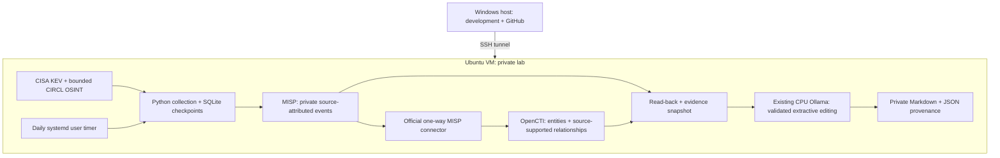

# Automated threat intelligence briefs

Collect public threat intelligence, store private MISP events, import them into OpenCTI with its supported MISP connector, and generate daily evidence-grounded Markdown using an existing local Ollama model. This is a resource-conscious personal lab and portfolio project.

**Current status:** collection and automated tests have run on the target VM. Docker is absent; MISP and OpenCTI have not been deployed or functionally validated. The repository includes a digest-pinned deployment candidate, not a claim that the complete platform is operating. See [validation](docs/validation.md) for actual evidence and [deployment](docs/deployment.md) for the next approval boundary.



The application has no Python runtime dependencies beyond Python 3.11+. SQLite tracks source observations, content changes, MISP synchronization, and reporting independently. Deterministic MISP event/attribute UUIDs reconcile retries. Reports acknowledge only successfully written records; backlog remains queued. Overlapping executions are blocked by an OS lock.

## Run without infrastructure

From the repository root on Ubuntu:

```sh
PYTHONPATH=src python3 -m unittest discover -s tests -v
PYTHONPATH=src python3 -m ti_brief.cli --demo
PYTHONPATH=src python3 -m ti_brief.cli --collect-only
python3 scripts/validate.py
```

The demo is fully offline, uses reserved documentation indicators, and writes isolated `data/demo` and `reports/demo` directories. Collection-only downloads public feeds into `data/live` without platform writes or inference. It is not an end-to-end deployment test. On PowerShell, set `$env:PYTHONPATH='src'` and run `python -m ...` separately.

## Feed scope and evidence

| Adapter | Default | Scope and limits |
| --- | --- | --- |
| CISA KEV JSON | Yes | Catalog entries added in the last 14 days; exploit exposure is not inferred |
| CIRCL MISP OSINT | Yes | At most 3 recently modified events, 20 supported attributes per event; not exhaustive ingestion |
| Feodo CSV | No | Optional `--feeds cisa-kev,feodo`; rejects missing or >7-day-old source timestamps; stale in assessment |

CIRCL accepts individual IPs, domains, URLs, MD5/SHA1/SHA256 hashes, and CVEs from event/object attributes. Composite or invalid values are skipped, rather than guessed. Independent sources are preserved separately; a single normalized indicator can therefore have several observations. The supported MISP connector handles native STIX-compatible entity conversion and correlation in OpenCTI. This first release does not implement a TAXII server/client, full STIX bundle ingestion, ATT&CK seeding, or speculative actor/technique mapping.

Daily briefs distinguish source publication/catalog-addition, source modification, source-observed occurrence when available, and local ingestion. Historical records that are newly collected are not described as newly occurring attacks. Ranking is explainable: KEV 90, other source observations 60, then stable evidence ID. Up to 8 records are briefed per run; collection and MISP sync have separate bounds.

## Reporting and model boundaries

After platform deployment and configuration:

```sh
python3 scripts/init_env.py
# Select an existing model in .env; no model downloads occur automatically.
PYTHONPATH=src python3 -m ti_brief.cli
```

The LLM edits an **extractive** summary: it chooses and orders exact source excerpts tied to known evidence IDs. It cannot add narrative facts, citations, indicators, commands or relationships. Local validation rejects unsupported IDs/text or extra fields. Facts and actions elsewhere in the brief come from deterministic source rendering; quoted source claims still need analyst review. If inference fails, a marked fallback is saved, exit status is 2, and records remain pending for retry. Platform/feed failures exit 1; complete runs exit 0. A no-change day produces an explicit quiet-day report.

Use `--prepare-only` to collect/synchronize/query platforms and save context, then `--render-prepared` to run inference from that snapshot when platform containers are stopped. Snapshots expire after 24 hours and must exactly match the pending record versions. Service transitions are deliberate operator actions; the Python pipeline never stops unrelated workloads. See [resource planning](docs/resources.md).

Reports contain Executive Summary, Emerging Threats, Vulnerabilities, Indicators of Compromise, MITRE ATT&CK, Defensive Recommendations and Sources, plus a private JSON sidecar with evidence fingerprints and API context. [Synthetic example](examples/daily-brief.synthetic.md). Real reports and credentials stay outside version control. Review [security boundaries](SECURITY.md).

## Deployment and operation

- [Environment assessment and memory budget](docs/resources.md)
- [Incremental deployment, API validation, scheduling and recovery](docs/deployment.md)
- [Test evidence and remaining acceptance work](docs/validation.md)

Compose provides independent `misp`, `opencti`, and `integration` profiles, persistent named volumes, health checks, bounded logs and explicit memory/CPU limits. Only `127.0.0.1:8081` (MISP) and `127.0.0.1:8080` (OpenCTI) are published. Every image is pinned to a registry-verified immutable digest. `scripts/lock_images.py` intentionally refreshes tags/digests; `scripts/build_compose.py` regenerates plain Compose JSON, which Docker Compose accepts as YAML. These checks do not prove image compatibility at runtime.

The proposed timer runs once daily at 08:00 UTC (03:00 US Eastern in standard time; 04:00 in daylight time), with up to five minutes of jitter and persistent catch-up. It is not installed or enabled automatically. GitHub Actions tests synthetic functionality and Compose syntax; GitHub-hosted runners never receive lab credentials or run the daily live intelligence job.

Project source: [bran-dot-flake/STIX-TAXII-Threat-Intel-Automated-Summary](https://github.com/bran-dot-flake/STIX-TAXII-Threat-Intel-Automated-Summary).
