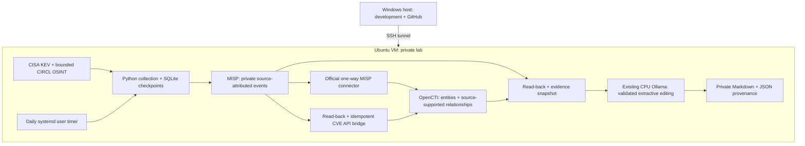

# Automated threat intelligence briefs

Collect public threat intelligence, store private MISP events, import them into OpenCTI with its supported MISP connector, and generate daily evidence-grounded Markdown using an existing local Ollama model. This is a resource-conscious personal lab and portfolio project.

**Current status:** MISP 2.5.51 and OpenCTI 7.261109.0 are deployed on the target Ubuntu VM. All 41 collected observations passed exact entity/provenance checks, and the existing local Ollama model produced a validated real brief with the platform containers stopped. Daily staged-job and timer acceptance are tracked in [validation](docs/validation.md). This is a small-data lab below upstream OpenCTI production sizing.



The application has no Python runtime dependencies beyond Python 3.11+. SQLite tracks source observations, content changes, MISP synchronization, the CVE bridge, and reporting independently. Deterministic MISP event/attribute UUIDs and native OpenCTI upserts reconcile retries. Existing SQLite state gains the new bridge checkpoint through a nondestructive column migration. Reports acknowledge only successfully written records; backlog remains queued. Overlapping executions are blocked by an OS lock.

## Run without infrastructure

From the repository root on Ubuntu:

```sh
PYTHONPATH=src python3 -m unittest discover -s tests -v
PYTHONPATH=src python3 -m ti_brief.cli --demo
PYTHONPATH=src python3 -m ti_brief.cli --collect-only
python3 scripts/validate.py
```

The demo is fully offline, uses reserved documentation indicators, and writes isolated `data/demo` and `reports/demo` directories. Collection-only downloads public feeds into `data/live` without platform writes or inference. It is not an end-to-end deployment test. On PowerShell, set `$env:PYTHONPATH='src'` and run `python -m ...` separately.

## Feed scope and evidence

| Adapter | Default | Scope and limits |
| --- | --- | --- |
| CISA KEV JSON | Yes | Catalog entries added in the last 14 days; exploit exposure is not inferred |
| CIRCL MISP OSINT | Yes | At most 3 recently modified events, 20 supported attributes per event; not exhaustive ingestion |
| Feodo CSV | No | Optional `--feeds cisa-kev,feodo`; rejects missing or >7-day-old source timestamps; stale in assessment |

CIRCL accepts individual IPs, domains, URLs, MD5/SHA1/SHA256 hashes, and CVEs from event/object attributes. Composite or invalid values are skipped, rather than guessed. Independent sources are preserved separately; a single normalized indicator can therefore have several observations. The supported MISP connector handles indicators, observables and their native relationships. Its deployed version omits standalone vulnerability attributes, so a separate API bridge upserts CVEs after MISP read-back, carrying MISP and original-source references. Each entity type has one writer; there is no circular synchronization. This first release does not implement a TAXII server/client, full STIX bundle ingestion, ATT&CK seeding, or speculative actor/technique mapping.

Daily briefs distinguish source publication/catalog-addition, source modification, source-observed occurrence when available, and local ingestion. Historical records that are newly collected are not described as newly occurring attacks. Ranking is explainable: KEV 90, other source observations 60, then stable evidence ID. Up to 8 records are briefed per run; collection and MISP sync have separate bounds.

## Reporting and model boundaries

After platform deployment and configuration:

```sh
python3 scripts/init_env.py
# Select an existing model in .env; no model downloads occur automatically.
PYTHONPATH=src python3 -m ti_brief.cli
```

The LLM edits an **extractive** summary: it chooses and orders source excerpts tied to known evidence IDs. JSON-schema branches bind each ID to a fixed set of exact source choices; local validation independently rejects unsupported IDs/text, duplicates, empty selections on nonempty evidence, or extra fields. It cannot add narrative facts, citations, indicators, commands or relationships. Facts and actions elsewhere in the brief come from deterministic source rendering; quoted source claims still need analyst review. If inference fails, a marked fallback is saved, exit status is 2, and records remain pending for retry. Platform/feed failures exit 1; complete runs exit 0. A no-change day produces an explicit quiet-day report.

Use `--sync-misp-only` for the first ingestion pilot. Use `--prepare-only --sync-timeout 900` to synchronize/query both platforms and save verified context, then `--render-prepared` with the same `--max-records` bound to infer when platform containers are stopped. Snapshots expire after 24 hours and must exactly match the pending record versions. The staged orchestrator checks container ownership and never stops unrelated workloads. `TI_RESIDENT_PROFILE=misp` leaves MISP running afterward; `all` restores both UIs after a measured combined pilot. See [resource planning](docs/resources.md).

Reports contain Executive Summary, Emerging Threats, Vulnerabilities, Indicators of Compromise, MITRE ATT&CK, Defensive Recommendations and Sources, plus a private JSON sidecar with evidence fingerprints and API context. [Synthetic example](examples/daily-brief.synthetic.md). Real reports and credentials stay outside version control. Review [security boundaries](SECURITY.md).

## Deployment and operation

- [Environment assessment and memory budget](docs/resources.md)
- [Incremental deployment, API validation, scheduling and recovery](docs/deployment.md)
- [Test evidence and remaining acceptance work](docs/validation.md)

Compose provides independent `misp`, `opencti`, and `integration` profiles, persistent named volumes, health checks, bounded logs and explicit memory/CPU limits. Only `127.0.0.1:8081` (MISP) and `127.0.0.1:8080` (OpenCTI) are published. Every image is pinned to a registry-verified immutable digest. `scripts/lock_images.py` intentionally refreshes tags/digests; `scripts/build_compose.py` regenerates plain Compose JSON, which Docker Compose accepts as YAML. These checks do not prove image compatibility at runtime.

The reviewed system timer runs the job as `vboxuser` once daily at 08:00 UTC (03:00 US Eastern in standard time; 04:00 in daylight time), with up to five minutes of jitter, persistent catch-up and bounded failure retries. Installing it requires explicit administrative approval. GitHub Actions tests synthetic functionality and Compose syntax; GitHub-hosted runners never receive lab credentials or run the daily live intelligence job.

Project source: [bran-dot-flake/STIX-TAXII-Threat-Intel-Automated-Summary](https://github.com/bran-dot-flake/STIX-TAXII-Threat-Intel-Automated-Summary).
