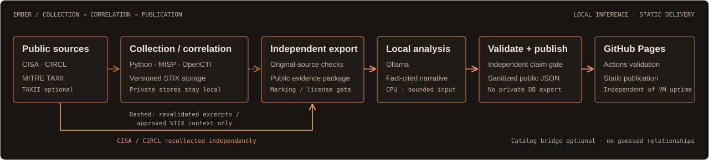
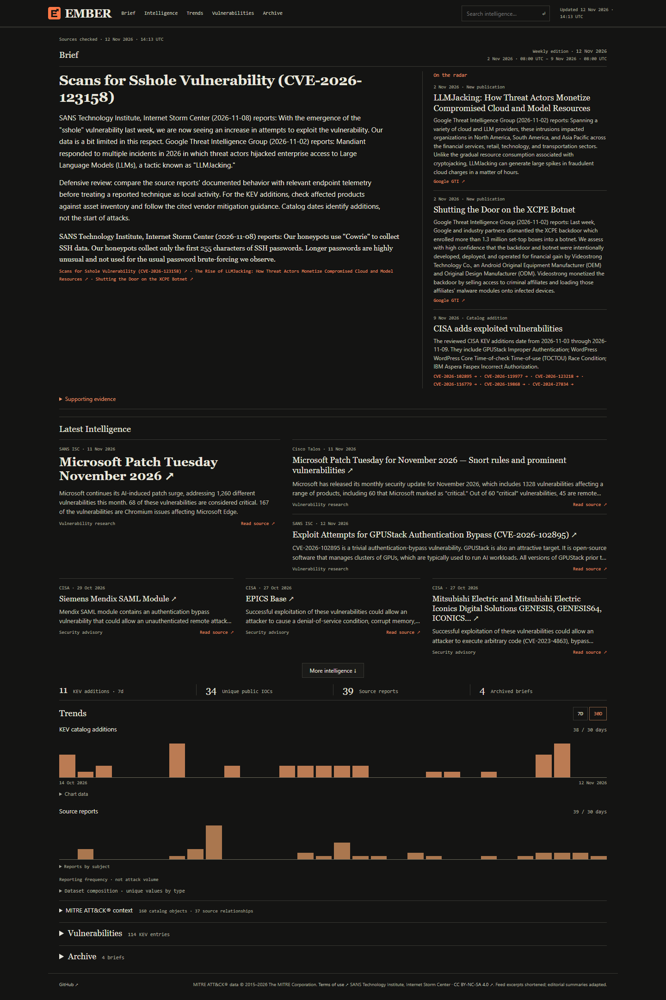

<h1 align="center">Autonomous Threat Intelligence Pipeline, EMBER</h1>

<strong>MISP · OpenCTI · STIX/TAXII · Ollama · GitHub Pages</strong>

  
  
  
  
  

Public threat signals become private, source-linked intelligence and local LLM briefings. A separate validation boundary publishes the daily edition to GitHub Pages.

  <a href="https://brandonchaney.dev/STIX-TAXII-Threat-Intel-Automated-Summary/">Live Observatory ↗</a> ·
  <a href="#overview">Overview</a> ·
  <a href="#architecture">Architecture</a> · <a href="#implementation">Implementation</a> ·
  <a href="#results">Results</a> · <a href="#documentation">Documentation</a>

## Overview

EMBER collects intelligence daily and publishes weekly briefings plus significant interim updates. CISA, CIRCL and MITRE ATT&CK® support the private MISP/OpenCTI lab; official SANS ISC, Cisco Talos and Google Threat Intelligence RSS feeds broaden the public editorial coverage. An existing CPU-only Ollama model composes from validated evidence. Quiet collections refresh the data while keeping the latest substantive briefing visible with its original date.

The project explores the engineering needed to make that workflow dependable: interoperable STIX/TAXII ingestion, source-aware correlation, independent read-back, bounded local inference and a deliberate public/private boundary. The static site stays available when the lab is offline; fresh intelligence resumes when collection returns.

## Architecture

MISP/OpenCTI and versioned STIX storage serve the private lab. The public exporter independently recollects approved CISA/CIRCL evidence and bounded official research-feed metadata; only revalidated excerpts and approved MITRE projections can cross from lab state. Ollama composes from the sanitized publication input, and a separate claim gate precedes the public JSON commit. TAXII and its catalog bridge are optional. [Detailed data paths and operations](docs/deployment.md#detailed-data-paths).

## Implementation

### Collection and correlation

Python normalizes CISA KEV additions and a bounded CIRCL sample, writes source-attributed private MISP events, and verifies OpenCTI entities against exact values and MISP references. An official MISP connector handles indicators/observables; a CVE bridge covers standalone vulnerabilities. STIX/TAXII processing retains original objects, source relationships, version history and resumable checkpoints in a separate store. Relationships are never inferred from matching names. [STIX/TAXII contract](docs/stix-taxii.md).

### Analysis and reporting

Completed seven-day windows drive the weekly edition. Interim updates require concrete source-reported developments; a new feed item alone is insufficient. Exact report references and CVEs support grouping and continuity, while timestamps distinguish publication from collection. Ollama arranges cited findings and defensive review steps; deterministic checks reject unsupported claims. Rejected or unavailable inference uses a checked fallback, and repeat runs preserve accepted editions. [Reporting and grounding](docs/briefing.md).

### Publication

The exporter independently checks original sources and produces a validated public JSON snapshot. GitHub Actions builds the static website from that snapshot, preserving source links, evidence views and historical editions. Compact charts count KEV additions and distinct source reports by subject and date; reporting frequency is not attack volume. Private platform databases stay in the lab. [Publication workflow](docs/publication.md).

## Results

[Take a look at EMBER ↗](https://brandonchaney.dev/STIX-TAXII-Threat-Intel-Automated-Summary/)

## Documentation

| Guide | Purpose |
| --- | --- |
| [STIX/TAXII](docs/stix-taxii.md) | Parsing, synchronization, version history and the optional catalog bridge |
| [Briefing](docs/briefing.md) | Editorial grouping, claim checks, fallbacks and reporting chronology |
| [Publication](docs/publication.md) | Public schemas, original-source export and GitHub Pages |
| [Validation](docs/validation.md) | Current checks, integration acceptance and detailed historical evidence |
