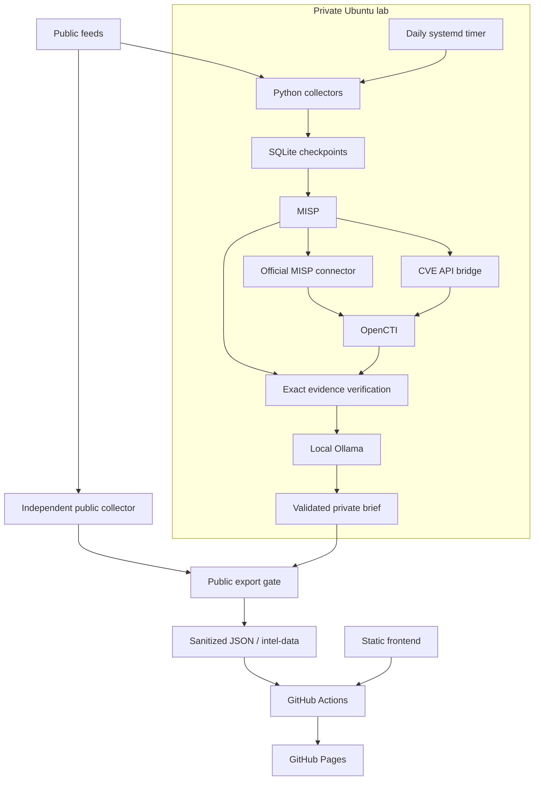

<h1 align="center">EMBER · Threat Intelligence Observatory</h1>

<hr>

<p align="center"><strong>MISP · OpenCTI · Ollama · Automated Threat Intelligence</strong></p>

<p align="center">
  
  
  
  
</p>

<p align="center">Public threat signals become private, correlated evidence and daily source-grounded briefs.<br>A separate publication boundary brings the safe results to a public intelligence dashboard.</p>

<p align="center">
  <a href="https://bran-dot-flake.github.io/STIX-TAXII-Threat-Intel-Automated-Summary/">Live Observatory ↗</a> ·
  <a href="#overview">Overview</a> · <a href="#objectives">Objectives</a> ·
  <a href="#architecture">Architecture</a> · <a href="#implementation">Implementation</a> ·
  <a href="#results">Results</a> · <a href="#setup">Setup</a>
</p>

<hr>

## Overview

Threat intelligence arrives in separate catalogs, indicators, and advisories. EMBER brings those signals together in a daily publication that makes findings traceable to their sources. Its dashboard combines an exploitation watch, indicator statistics, an editorial advisory feed, and archived intelligence briefs.

Behind the website is an Ubuntu lab. MISP organizes source-attributed events and indicators; OpenCTI provides a structured intelligence graph. An existing local Ollama model selects relevant source excerpts for a daily report. Python validates those selections and renders the facts, chronology, and defensive guidance. The model supplies no numerical metrics or speculative relationships.

The website is static. It contains a separate, validated public-source projection and never connects to the lab. Readers can use the last published edition while the VM or model is offline.

## Objectives

- Normalize public intelligence while preserving source attribution and distinct publication, collection, and incident dates.
- Verify MISP/OpenCTI synchronization with durable checkpoints and bounded resource use.
- Use local inference for readable, evidence-grounded briefings, with explicit validation and fallback behavior.
- Make intelligence accessible through useful charts, responsive editorial layouts, and historical reports.
- Automate outbound publishing without exposing private infrastructure.

## Architecture



MISP, OpenCTI, the connector, the CVE bridge, and Ollama have been exercised on the target VM. They remain optional dependencies of the public collector. TAXII ingestion, general STIX bundle ingestion, and broader actor/ATT&CK adapters are future work; the repository's original name does not imply those features are implemented.

## Implementation

### Collection and correlation

SQLite tracks source observations and independent synchronization/reporting checkpoints. Stable MISP UUIDs and native OpenCTI upserts reconcile retries. The official MISP connector imports indicators and observables. Its deployed version omits standalone vulnerability attributes, so a CVE-only API bridge fills that gap after MISP read-back. Strict reporting verifies exact entity values and MISP provenance; broad search candidates do not count as proof.

| Source | Private pipeline | Public publication |
| --- | --- | --- |
| CISA KEV JSON | Catalog additions from the last 14 days | Up to 90 days of catalog additions |
| CIRCL public MISP OSINT | Three recent events × twenty supported attributes | Same bounded sample, explicit CLEAR/WHITE and address checks |
| CISA advisory RSS | Independent editorial adapter | Up to eighteen articles from the last 30 days |
| Feodo CSV | Optional; disabled after stale-source detection | Not published |

These are source assertions. KEV `dateAdded` is a catalog date, not a disclosure or exploitation date. Newly collected infrastructure is not necessarily newly active. The initial adapters do not support reliable CVSS, malware-family, actor, or ATT&CK statistics, so those views are not fabricated.

### Local LLM reporting

Ollama performs **extractive editing**: it chooses and orders complete source excerpts tied to known evidence IDs. Per-record JSON-schema alternatives constrain generation. Independent local validation rejects unknown IDs, invented text, duplicates, extra fields, and empty selections on nonempty evidence. No execution tools are supplied to the model.

Up to eight observations are briefed per run. The renderer supplies citations, timestamps, and source recommendations. Failed inference writes a marked fallback, exits with status 2, and leaves records pending. Complete runs exit 0; other failures exit 1. Quiet days produce an explicit no-new-findings edition. [Synthetic private report](examples/daily-brief.synthetic.md).

The resource-aware orchestrator prepares verified evidence with the platforms running, stops only this project's containers for CPU inference, then restores the selected resident profile. Images are digest-pinned. The approved system timer runs daily at 08:00 UTC with up to five minutes of jitter, persistent catch-up, and bounded retries. No additional model or server is needed for the website.

### Public publication and presentation

The exporter recollects original allowlisted public sources. It never uploads the local database, raw Markdown, or private JSON sidecars. Brief excerpts are promoted only after the entire evidence batch matches independently recollected public versions and its digest. Private platform context is discarded. CIRCL restrictions are checked at event, object, and attribute level; nonpublic addresses and suspicious text are rejected. Indicators are defanged.

The publisher uses existing `gh` authentication to commit exactly one validated `snapshot.json` to an isolated `intel-data` branch. It never stages the working directory, exports a token, or force-pushes. An explicit dispatch builds `main` with that snapshot, validates it again, and deploys only allowlisted assets. Source failures retain previous validated data and original last-success times; failed deployment leaves the previous site online.

The frontend is plain HTML, CSS, and JavaScript, without a framework, CDN, analytics tracker, or external font service. Charcoal panels, orange emphasis, editorial serif headlines, and technical metadata give it a consistent identity. Original SVG illustrations accompany short attributed CISA excerpts. Charts use deterministic code, UTC dates, and deduplicated values. Keyboard navigation, native detail dialogs, chart data tables, responsive layouts, and explicit empty/stale states support everyday use.

## Results

[Open the live observatory](https://bran-dot-flake.github.io/STIX-TAXII-Threat-Intel-Automated-Summary/).


<details>
<summary>The intelligence desk</summary>


</details>

<details>
<summary>Mobile dashboard</summary>


</details>

The November 11, 2026 acceptance snapshot contained **159 public observations**: **114 unique KEV entries** and **45 unique public IOCs**, plus **18 CISA advisories** and **two accepted public briefs**. The 30-day chart contained forty catalog additions, calculated from source dates. These are dated validation results, not throughput or comprehensive coverage claims; live figures change with collection.

The private lab previously verified all forty-one collected observations against exact OpenCTI entities and MISP provenance. A real systemd-managed run completed successfully, restored both platform UIs, and unloaded Ollama. Its orchestration process measured a 48.3 MiB peak; platform and model memory are separate. [Backend acceptance evidence](docs/validation.md).

New tests cover public restrictions, source failure caching, exact brief promotion, publication isolation, metric deduplication, UTC windows, and search calculations. Browser acceptance covers the four primary views at phone, tablet, and desktop widths, chart/category filters, source details, CVE search, and report history. [Publication contract and operations](docs/publication.md).

## Setup

Python **3.11+** runs collection, reporting, export, and builds without runtime dependencies. Node 24 is used only for calculation tests. The full lab additionally needs Docker Compose and an existing Ollama installation. Publishing needs authenticated GitHub CLI access to repository contents and workflow dispatch.

### Explore without the platforms

From a fresh checkout on Ubuntu:

```sh
export PYTHONPATH=src
python3 -m unittest discover -s tests -v
node --test tests/dashboard.test.mjs
python3 scripts/validate.py
python3 -m ti_brief.cli --demo
python3 scripts/build_dashboard.py --demo
python3 -m http.server 4173 --bind 127.0.0.1 --directory dist
```

Open `http://127.0.0.1:4173`. The dashboard demo is visibly synthetic and rejected by the live publisher. Omit `--demo` to explore the empty state. In PowerShell, set `$env:PYTHONPATH='src'` before Python commands.

Collect real public data without MISP, OpenCTI, or Ollama:

```sh
PYTHONPATH=src python3 scripts/export_publication.py
python3 scripts/build_dashboard.py --snapshot data/publication/snapshot.json
```

The export populates analytics and news immediately. Public brief history appears when accepted local reports exist; the exporter makes no extra model call.

### Configure the private lab

```sh
python3 scripts/assess.py
python3 scripts/init_env.py
# Edit .env locally; choose an existing OLLAMA_MODEL.
PYTHONPATH=src python3 scripts/daily_staged.py --manage-project
```

Review [resource planning](docs/resources.md) and the [incremental deployment guide](docs/deployment.md) before installing or starting services. The measured target has about 10 GiB of guest RAM and CPU-only inference, below OpenCTI production sizing. `TI_RESIDENT_PROFILE=misp` is the default; `all` requires a measured combined pilot. Existing unrelated workloads remain outside this project's scope.

| Configuration | Purpose |
| --- | --- |
| `MISP_URL`, `MISP_API_KEY` | Private MISP API and read-back |
| `OPENCTI_URL`, `OPENCTI_TOKEN` | Private graph API and provenance verification |
| `OLLAMA_URL`, `OLLAMA_MODEL` | Existing local inference endpoint and model |
| `TI_RESIDENT_PROFILE` | `misp` or measured `all` after reporting |
| `TI_PUBLICATION_ENABLED` | Set `true` to export/publish after daily staged runs |
| `TI_PUBLICATION_REPOSITORY` | Target repository; update when using a fork |

All actual credentials, reports, state, models, and logs stay ignored. See [.env.example](.env.example) and [SECURITY.md](SECURITY.md).

### Publish to GitHub Pages

1. Authenticate `gh` as the collector account, with repository/workflow access. Do not export its token into source.
2. Enable **Settings → Pages → Source: GitHub Actions**.
3. For a fork, update frontend/README repository links and `TI_PUBLICATION_REPOSITORY` in `.env`.
4. Run the exporter with `--publish` to create/update `intel-data` and dispatch the workflow on `main`.
5. Set `TI_PUBLICATION_ENABLED=true` for daily runs through the existing system timer.

```sh
PYTHONPATH=src python3 scripts/export_publication.py --publish
gh run list --workflow pages.yml --limit 5
```

The workflow must exist on `main`. If the first automatic deployment begins before the new data branch exists, rerun it after export. GitHub-hosted runners receive no lab credentials. Relative assets and hash navigation support Pages project URLs. Publication is outbound-only and requires no new VM firewall exposure.

### Repository map

| Path | Responsibility |
| --- | --- |
| `src/ti_brief/feeds.py`, `model.py`, `store.py` | Normalization and durable ingestion state |
| `src/ti_brief/platforms.py`, `cli.py` | MISP/OpenCTI integration and staged execution |
| `src/ti_brief/report.py` | Ollama contract, validation, and private report rendering |
| `src/ti_brief/publication.py`, `publish.py` | Safe public projection and outbound publishing |
| `website/` | Static frontend and original editorial artwork |
| `scripts/` | Assessment, orchestration, export, build, and verification |
| `deploy/` | Locked Compose configuration and reviewed systemd units |
| `tests/`, `examples/`, `docs/` | Automated checks, labeled fixtures, and operational evidence |

Source failures appear under **Sources & status**. A missing public brief means no complete evidence batch has passed the gate yet; inspect local reports rather than weakening validation. Export failures are logged by redacted error class. A data-branch commit is separate from deployment success: inspect Actions for publication status.

The site remains accessible during a VM outage but cannot collect fresh intelligence then. Coverage is deliberately bounded. Broader feeds, TAXII/STIX support, richer source-supported relationships, backup restoration, and larger-scale operation remain future work.
