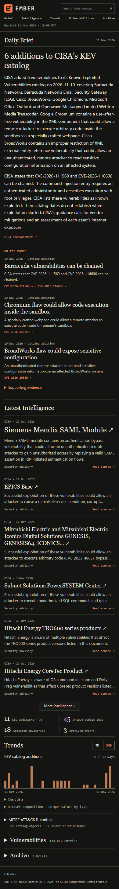

<h1 align="center">EMBER · Threat Intelligence Observatory</h1>

<strong>MISP · OpenCTI · STIX/TAXII · Ollama · GitHub Pages</strong>

  
  
  
  
  

Public threat signals become private, source-linked intelligence and local LLM briefings. A separate validation boundary publishes the daily edition to GitHub Pages.

  <a href="https://brandonchaney.dev/STIX-TAXII-Threat-Intel-Automated-Summary/">Live Observatory ↗</a> ·
  <a href="#overview">Overview</a> ·
  <a href="#architecture">Architecture</a> · <a href="#implementation">Implementation</a> ·
  <a href="#results">Results</a> · <a href="#documentation">Documentation</a>

## Overview

EMBER turns public threat intelligence into a concise daily publication. It collects CISA vulnerability/advisory feeds, CIRCL indicators and structured MITRE ATT&CK® data, organizes evidence in MISP and OpenCTI, and uses an existing CPU-only Ollama model for source-grounded reporting. The website brings together a daily brief, supporting evidence, additional intelligence, trends, searchable vulnerabilities and an archive.

The project explores the engineering needed to make that workflow dependable: interoperable STIX/TAXII ingestion, source-aware correlation, independent read-back, bounded local inference and a deliberate public/private boundary. The static site stays available when the lab is offline; fresh intelligence resumes when collection returns.

## Architecture

MISP/OpenCTI and versioned STIX storage serve the private lab. The public exporter independently recollects approved CISA/CIRCL evidence; only revalidated excerpts and approved MITRE projections can cross from lab state. Ollama composes from the sanitized publication input, and a separate claim gate precedes the public JSON commit. TAXII and its catalog bridge are optional. [Detailed data paths and operations](docs/deployment.md#detailed-data-paths).

## Implementation

### Collection and correlation

Python normalizes CISA KEV additions and a bounded CIRCL sample, writes source-attributed private MISP events, and verifies OpenCTI entities against exact values and MISP references. An official MISP connector handles indicators/observables; a CVE bridge covers standalone vulnerabilities. STIX/TAXII processing retains original objects, source relationships, version history and resumable checkpoints in a separate store. Relationships are never inferred from matching names. [STIX/TAXII contract](docs/stix-taxii.md).

### Analysis and reporting

The editorial edition draws from the full validated publication, rather than one synchronization batch. Related indicators share their original report; CVEs remain individually inspectable. Source publication, catalog additions, substantive updates and collection times remain distinct. Ollama drafts cited claims, while deterministic checks reject unsupported wording, identifiers, numbers or relationships. Unverified prose stays private or receives a source-grounded fallback. [Reporting and grounding](docs/briefing.md).

### Publication

The exporter independently checks original sources and produces a validated public JSON snapshot. GitHub Actions builds the static website from that snapshot, preserving source links, evidence views and historical editions. Private platform databases stay in the lab. [Publication workflow](docs/publication.md).

## Results

| Capability | Verified result |
| --- | --- |
| Platform integration | **41 observations** passed exact MISP/OpenCTI value and provenance checks in the November 10, 2026 pilot. |
| Structured ingestion | **220 original STIX objects** stored in a bounded live TAXII acceptance run on November 11, with version-aware replay and source relationships. |
| Catalog bridge | A real **three-object** OpenCTI import repeated with **zero additional writes**. |
| Local reporting | Real CPU Ollama output produced a checked **143-word editorial overview**. A separate systemd-managed reporting run completed successfully. |
| Public delivery | HTTPS GitHub Pages publication, independent source validation, searchable evidence and retained historical editions. |
| Automated checks | Python 3.11/3.13/3.14, Node calculation/search checks and Chrome acceptance at **390 / 768 / 1440 px**. |

These are dated lab results and bounded samples, not complete ATT&CK coverage or production-scale performance. [Current validation summary and acceptance record](docs/validation.md#current-validation-summary).

[Explore the live publication ↗](https://brandonchaney.dev/STIX-TAXII-Threat-Intel-Automated-Summary/)

Phone layout

## Documentation

| Guide | Purpose |
| --- | --- |
| [STIX/TAXII](docs/stix-taxii.md) | Parsing, synchronization, version history and the optional catalog bridge |
| [Briefing](docs/briefing.md) | Editorial grouping, claim checks, fallbacks and reporting chronology |
| [Publication](docs/publication.md) | Public schemas, original-source export and GitHub Pages |
| [Validation](docs/validation.md) | Current checks, integration acceptance and detailed historical evidence |
